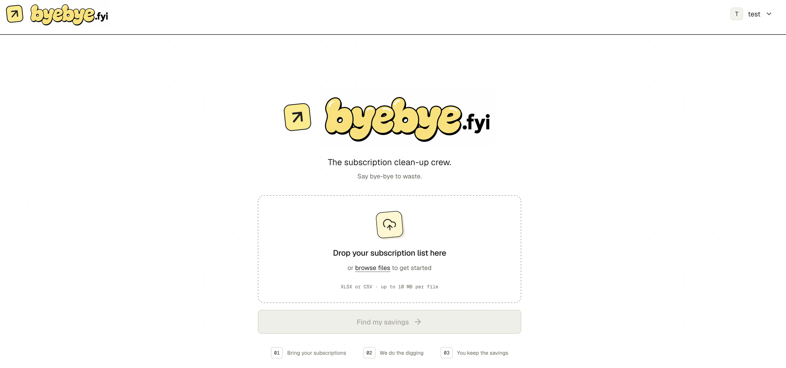

# byebye.fyi

**Say bye-bye to waste.**

Organisations pay for hundreds of subscriptions. But are they paying for what
people actually use? **byebye.fyi** brings subscription spend, active usage and
available plans into one workspace, helping universities and businesses find
the right subscriptions at the right price.

Upload your subscription list. Our AI agents do the digging. You keep the savings.

**[Try byebye.fyi →](https://byebye.fyi)**

## How it works

### 1. Bring your subscriptions

Drag in an Excel or CSV file containing your organisation's subscriptions.
byebye.fyi extracts the services and any user counts or spending figures, then
saves them in your workspace. A service name is all you need to get started.

Create separate workspaces for different teams, departments or organisations,
and switch between them from the header.

### 2. Let the agents do the research

Gemini-powered agents research each service's subscription tiers, prices, user
limits and billing options. They also identify what each service does, assigning
categories such as News, Research, Design and Productivity, alongside useful tags
and descriptions.

Subscriptions are analysed in parallel. Cards show their progress as results
arrive, and background jobs keep running even after you close the browser.

### 3. Fill in the gaps with SSO

SSO activity reveals how many people actually use each service. byebye.fyi
processes login logs and counts distinct users with a successful login in the
**last three months**, rather than counting purchased seats or historical accounts.

Use **Get with SSO** on an individual subscription, or **Fill gaps & analyse** to
complete missing usage data across your workspace. You can also enter user counts
and spending figures manually; each count shows its source.

### 4. Find the right plan

The analysis compares active users against plan capacities and costs, identifies
the lowest-cost eligible tier, and explains the recommendation.

- **Monthly and yearly options** receive separate comparisons, including the
  upfront annual payment and monthly-equivalent cost.
- **Potential savings** show how much less you could spend each month and year.
- **Missing current spend** still produces a plan recommendation based on usage.
- **No action needed** highlights subscriptions whose current spend already
  beats or matches the available alternatives.

Select a card to open its side panel and explore usage, plan details, pricing
sources, recommendations and agent activity while keeping the rest of your
subscriptions in view.

### 5. Ask better questions about your stack

Search by service name, filter by category and status, or narrow the results by
user count, monthly spend, savings, currency and usage-data source.

The AI filter turns questions like this into the corresponding filters:

> Show news subscriptions with fewer than 100 users, costing over £500 a month,
> where we could save at least £50.

## Under the hood

| Layer | Technology |
| --- | --- |
| Interface | Next.js, React, TypeScript, Tailwind CSS, Radix UI, Lucide |
| API | Python, FastAPI, Pydantic |
| AI | Gemini tool-calling agents and Google Search grounding |
| Storage | SQLite with persistent subscription data, login logs and job queues |
| Background processing | Concurrent Python workers, six subscription jobs at a time |
| Deployment | Docker Compose, nginx, HTTPS |

Agents use tools to research plans, inspect SSO logs, count active users and
calculate recommendations. Capacity and pricing calculations determine the
comparison figures, while Gemini provides the explanations and natural-language
filtering. Subscription data reaches the interface through a typed HTTP API.

## Run the project

### With Docker

Copy the environment template:

```bash
cp .env.example .env
```

Set `GEMINI_API_KEY` in `.env`, then start the frontend, API and background worker:

```bash
docker compose up --build
```

Open **http://localhost:3000**.

| Environment variable | Purpose | Default |
| --- | --- | --- |
| `GEMINI_API_KEY` | Gemini API key | Set your key |
| `GEMINI_MODEL` | Model used by the agents | `gemini-3.8-flash` |
| `WORKER_CONCURRENCY` | Number of concurrent subscription jobs | `6` |
| `FRONTEND_PORT` | Local frontend port | `3000` |
| `BACKEND_PORT` | Local API port | `8000` |

Workspace data and background jobs persist in a Docker volume between restarts.

### Without Docker

Use Python 3.12+ and Node.js 22+. From the repository root:

```bash
cp .env.example .env
python3 -m venv .venv
.venv/bin/pip install -r backend/requirements.txt
npm ci --prefix frontend
```

Set `GEMINI_API_KEY` in `.env`, then run these in three terminals:

```bash
# API
cd backend
../.venv/bin/python -m uvicorn app.main:app --reload --env-file ../.env
```

```bash
# Background worker
cd backend
../.venv/bin/python -m app.worker
```

```bash
# Frontend
cd frontend
npm run dev
```

The app runs at **http://localhost:3000** and the API documentation is available
at **http://localhost:8000/docs**.

## Upload format

Upload `.csv` or `.xlsx` files. Include a service-name column; user counts,
monthly spend and currency are optional.

```csv
Service,Users,Monthly spend,Currency
Notion,35,1050,GBP
Figma,,2400,GBP
JSTOR,,200,GBP
Scopus,95,,GBP
```

Categories and tags are collected during research. An optional `Period` column
supports annual spending, which is normalised to a monthly amount for comparison.
GBP, USD and EUR are supported, with comparisons kept within each currency.

**[Download the 21-subscription example CSV](frontend/public/test-subscriptions.csv)**

## Tests

```bash
# Backend
cd backend
../.venv/bin/python -m pytest -q
```

```bash
# Frontend and browser workflow
cd frontend
npm run lint
npm run build
npx playwright install chromium
npm run test:e2e
```

To exercise the deployed upload, analysis, SSO and filtering workflow:

```bash
cd frontend
npm run test:deployment
```
